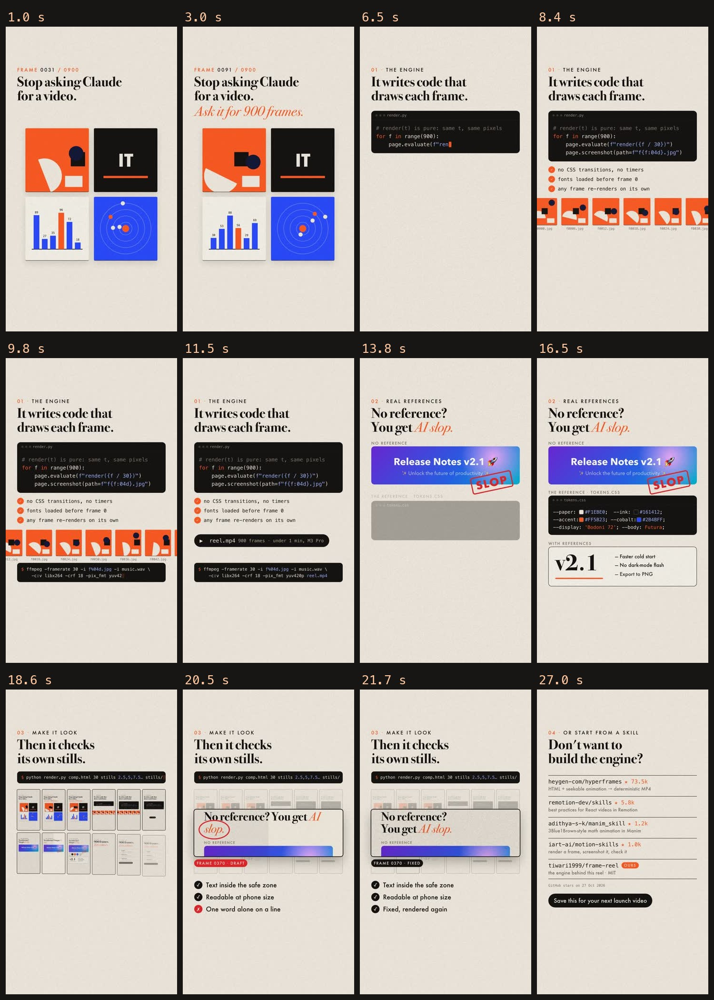

# frame-reel

An agent skill for making short videos from code, one frame at a time. A page draws each frame as a pure function of time, Playwright screenshots all 900 of them, numpy synthesises the music and ffmpeg stitches the mp4. There's no video editor and no timeline.



The reel above was made with it: 30 s, 1080x1920, 900 frames, rendered in under a minute on an M3 Pro.

## Install

```bash
git clone https://github.com/Tiwari1999/frame-reel ~/.claude/skills/frame-reel
pip install playwright numpy scipy pillow
playwright install chromium
brew install ffmpeg        # or your package manager
```

Then ask Claude Code for a reel. It reads `SKILL.md` when the request matches.

## Try the example

```bash
cd ~/.claude/skills/frame-reel/example
python ../scripts/render.py comp.html 6 all frames
python music.py music.wav
../scripts/mux.sh frames music.wav demo.mp4
```

## What's in it

| File | Job |
|---|---|
| `SKILL.md` | The method: beat grid, real references, `render(t)` rules, the stills check, render and mux |
| `scripts/render.py` | Opens the page in headless Chromium, calls `render(t)` per frame, screenshots it. `stills` mode renders chosen times only |
| `scripts/engine.js` | Timing and easing helpers, scene fades, word-by-word headline stagger |
| `scripts/sheet.py` | Tiles stills into one contact sheet to check by eye |
| `scripts/synth.py` | Numpy instruments, five buses, sidechain ducking, a room, a soft-clipped mix |
| `scripts/mux.sh` | H.264 + AAC, two-pass loudnorm to -14 LUFS / -1.5 dBTP |
| `example/` | A 6-second composition and score to copy from |

## The one rule

`render(t)` must depend on `t` and nothing else: no CSS transitions, timers, `requestAnimationFrame`, clock reads or unseeded randomness. That's what makes frame 370 render the same way every time, so you can fix one scene and re-render only what changed.

## Licence

MIT
